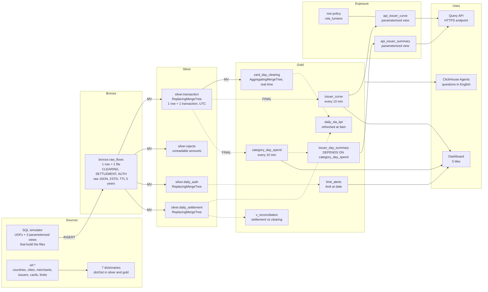

# ClickHouse from zero to advanced · Financial services workshop

One day of card payment clearing at an issuing bank, end to end, on **your own ClickHouse Cloud service**:
JSON files in a card scheme's format (CLEARING transaction detail, SETTLEMENT daily totals, AUTH daily authorized amount)
go to bronze, then silver, then gold, all the way to dashboards, an API and an AI agent.

> Only 90 minutes? Take the [short track](short/README.md): the essential concepts in 4 files.

All data is **simulated in SQL** (no customer files, no download, no external tools) and
deterministic: everyone gets the same numbers.

```
 JSON CLEARING/SETTLEMENT/AUTH ──► bronze ──MV──► silver ──MV / refreshable views──► gold ──► dashboard
   (SQL simulator)            1 row          1 row            spend, 9am SLA, alerts,        API
                              = 1 file       = 1 transaction  reconciliation                 AI agent
```

The six issuing banks, the merchants, the cards and the "EMEA Card Switch" scheme are fictional.
Countries, cities and merchant category codes (ISO 18245) are real. There is no real card number and no personal data.

---

## Workshop architecture

Every arrow is a SQL view: nothing runs outside ClickHouse.
Solid arrow: incremental materialized view, triggered on every INSERT. Dotted arrow: refreshable materialized view, recomputed every 10 minutes from the silver tables read with FINAL.



| Layer | Objects | Key takeaway |
|---|---|---|
| **Sources** | SQL simulator (`sim_*` functions, 3 parameterized views), `ref.*` reference tables, 7 dictionaries | everything is generated in SQL, deterministically |
| **Bronze** | `bronze.raw_flows` | 1 row = 1 raw JSON file (CLEARING, SETTLEMENT, AUTH), compressed about ×9, purged by a TTL |
| **Silver** | `transaction`, `rejects`, `daily_settlement`, `daily_auth` | 4 materialized views unfold the JSON on every INSERT; ReplacingMergeTree keeps the latest version |
| **Gold** | `card_day_clearing`, `daily_sla_kpi`, `issuer_curve`, `category_day_spend`, `issuer_day_summary`, `limit_alerts`, `v_reconciliation`, `card_profile` | 1 real-time materialized view, 5 refreshable materialized views (10 min or 9am), 1 plain view |
| **Exposure** | `api_issuer_curve`, `api_issuer_summary`, row policies of the `role_lumiere` role | the bank's portal only sends parameters; per-issuer security lives in the database |
| **Uses** | dashboard, Query API endpoint, ClickHouse Agents | everything reads gold, in a few milliseconds |

Around the main flow: the 1.5 billion transaction table (module 06), a month replayed and published with REPLACE PARTITION (module 07), observability through the `system.*` tables.

The words and abbreviations of the day are in the [lexicon](#lexicon).

---

## The business story, in five sentences

1. Every morning, the card scheme sends each issuing bank three kinds of files about the previous day: every transaction (**CLEARING**), the totals per card from its ledger (**SETTLEMENT**) and the amount authorized per card (**AUTH**).
2. The bank must have **99% of the transactions loaded by 9am** to settle and to feed its customers' statements: that is the SLA we measure.
3. Files arrive late, twice, or adjusted; some amounts are unreadable; some transactions are missing: the pipeline must stay correct anyway.
4. **Reconciliation** compares the ledger totals with the detail received, to the cent, and locates every break to the card and the day.
5. Business and corporate cards can go over their daily limit: the **over-limit alerts** compare each day with the limit in force that day.

---

## Before the session (20 min, the day before)

1. **Create your ClickHouse Cloud account** on [clickhouse.cloud](https://clickhouse.cloud) with your work email. New accounts come with trial credits, far more than the day needs.
2. **Create a service** with this configuration, the reference configuration of the workshop:

   | Setting | Value | Why |
   |---|---|---|
   | Region | the one closest to you (for example AWS **eu-central-1**, Frankfurt) | lower latency in the console |
   | Replicas | **3** | big scans are spread across the 3 (module 06) |
   | Memory per replica | **64 GB** (16 vCPU), **minimum = maximum** | fixed size: no waiting for autoscaling mid-demo |
   | Idling | **after 1 hour** of inactivity, at least | the service does not go to sleep during a break |

   The calculator on [clickhouse.com/pricing](https://clickhouse.com/pricing) gives the hourly rate of this configuration. A smaller service works too: modules 00 to 05 and 07 are light; in module 06, split the batches as the file explains.
3. **Write down the password** of the `default` user shown at creation. It is shown only once. Keep it in a password manager, never in a file of the repo.
4. Open your service's **SQL console** and run `SELECT version();`. If a version shows up, you are ready.
5. Optional, for catching up from the command line: install the native client.
   ```bash
   curl https://clickhouse.com/ | sh
   ```

---

## Schedule (5 h)

| Time | Module | What we do | Duration |
|---|---|---|---|
| 0:00 | Introduction | The platform: ClickHouse Cloud, separate storage and compute, ClickPipes, Agents | 15 min |
| 0:15 | **00** First steps | From `numbers()` to a daily settlement file in JSON, then 1 million transactions in one query | 15 min |
| 0:30 | **01** Fundamentals | MergeTree, sparse index, compression. 29 countries, 116 cities, 50,000 merchants and 1 million cards, generated in SQL | 25 min |
| 0:55 | **02** Bronze | The card payment simulator (UDFs, parameterized views) and 1,800 raw JSON files, 2.5 GiB | 25 min |
| 1:20 | *Break* | | 10 min |
| 1:30 | **03** Silver | Materialized views, triple ARRAY JOIN, backfill, resends, adjustments, daylight saving time | 35 min |
| 2:05 | **04** Dictionaries | In-memory reference data, the daily limit "at date" | 15 min |
| 2:20 | **05** Gold | Incremental MV, the sum trap, refreshable materialized views, the 9am SLA, over-limit alerts, settlement / clearing reconciliation, card profiles for data science | 35 min |
| 2:55 | *Break* | | 10 min |
| 3:05 | **06** Performance | 1.5 billion transactions, primary index, parallel replicas, projection, skip index, cache, advanced SQL | 30 min |
| 3:35 | **07** Operations | Replay and atomic publish, TTL, DELETE, row policies, observability in SQL | 25 min |
| 4:00 | **08** Dashboards, API, Agents | A 5-tile filterable dashboard, a secured Query API endpoint, ClickHouse Agents: questions, dashboards and data science | 40 min |
| 4:40 | Wrap-up | What we covered, going further, questions | 20 min |

Each module has one or more `.sql` files, to run **in order**. The [module 08 README](08_dashboards_agent/README.md) details the steps in the console (dashboard, API, agent).

---

## In the SQL console

1. Open the module's `.sql` file on GitHub, copy everything, paste it into a new console tab.
2. Shortcuts:

| Shortcut (Mac) | Windows / Linux | Effect |
|---|---|---|
| **Cmd + Enter** | Ctrl + Enter | Runs the **whole** tab |
| **Cmd + Shift + Enter** | Ctrl + Shift + Enter | Runs the **query under the cursor** |

3. To go step by step, put the cursor in a query and use **Cmd + Shift + Enter**. The `What to look for` comments say what to check (duration, rows read, result). [RESULTS.md](RESULTS.md) lists the numbers to compare with.
4. Each file ends with a **checkpoint**: a row of `OK`. A `FAIL` means a step was missed. Run the file again, it is idempotent (`CREATE OR REPLACE`, `IF NOT EXISTS`).

Good to know:
- The console gives up on a statement after **~60 s** (the query keeps running on the server). All scripts are split to stay below that on the reference configuration.
- A **"Query variables"** panel opens on parameterized views: leave it empty and close it.
- Module 06 inserts 1.5 billion transactions in 8 batches: one statement per batch to stay under the console limit.

---

## Catching up

Fallen behind, or a module failed? The [`run_all.sh`](run_all.sh) script replays the files with the native client, from your machine, in the `en/` folder:

```bash
cd en
export CH_HOST=<your-service>.<region>.clickhouse.cloud
export CH_PASSWORD='<password>'
```

```bash
./run_all.sh 01 04
```
Replays modules 01 to 04 inclusive, without a reset. Handy to catch up with the group.

```bash
./run_all.sh 05_gold
```
Resumes at a module and runs to the end.

```bash
./run_all.sh
```
Everything from scratch, reset included.

The detailed results of each file are in `logs/`. Modules depend on the previous ones: to resume at module 05, modules 00 to 04 must have run.

[`reset.sql`](reset.sql) drops **only** what the workshop created: the `ref`, `bronze`, `silver`, `gold`, `simulator` databases, the `sim_*` functions, the `dict_reader` user, the `role_lumiere` role and its row policies.

---

## Lexicon

Everything that shows up in the slides and in the repo, in one line.

| Card payments | | ClickHouse | | Platform and data | |
|---|---|---|---|---|---|
| **Issuer** | the bank that issued the card and holds the cardholder's account | **SQL** | the query language, used for the whole workshop | **JSON** | text format of the files received |
| **Acquirer** | the merchant's bank, which collects the payment | **MV** | materialized view: a trigger that transforms every INSERT | **API** | interface a program calls to query a service |
| **Scheme** | the card network that routes payments between acquirers and issuers (here the fictional "EMEA Card Switch") | **RMV** | refreshable materialized view: scheduled full recompute (10 min, 9am) | **S3 · GCS** | AWS and Google Cloud object storage |
| **Authorization** | the real-time yes or no of the issuer when the card is used | **FINAL** | reads the latest version of each row, no duplicates | **CDC** | Change Data Capture: continuous copy of a database's changes |
| **Clearing** | the transaction detail sent after the fact, used to post the payment to the account | **TTL** | time to live: automatic purge of rows that are too old | **OTel** | OpenTelemetry: standard for collecting logs, metrics, traces |
| **Settlement** | the money actually moving between banks, once a day, for the net total | **UDF** | user-defined SQL function, reusable everywhere | **MCP** | Model Context Protocol: plugs an AI agent into tools and data |
| **CLEARING · SETTLEMENT · AUTH** | the 3 flows of the workshop: every transaction, daily totals per card, daily authorized amount per card | **ASOF JOIN** | join on the closest value, for example at a date | **KPI** | key indicator, for example 99% of the transactions received by 9am |
| **POS · ECOM** | channels: in store (point of sale), online (e-commerce) | **ZSTD** | Zstandard: the algorithm that compresses columns | **SLA** | service level agreement: the commitment the KPI measures |
| **MCC** | merchant category code, 4 digits (ISO 18245): 5411 grocery stores, 5812 restaurants… | **UTC** | universal time, no daylight saving: the storage format | **BI** | business intelligence: dashboards and reports |
| **CONSUMER · BUSINESS · CORPORATE** | card segments: individuals (daily limit up to 15,000 EUR), small companies, large companies | | | **GDPR** | European regulation on personal data protection |
| **Daily limit** | the maximum a card may spend per day. Declined beyond it for consumers, "soft" (alert and fee) for business and corporate | | | **PCI DSS** | the security standard for card data. The workshop uses tokens, never real card numbers |
| **CLEARED · ADJUSTED** | stage of a transaction: first presentment, then a later correction | | | | |
| **Cross-border** | a payment at a merchant outside the home country of the card | | | | |
| **Reconciliation · break** | comparing two sources that should agree (ledger totals vs detail); a break is a difference | | | | |
| **Cut-off** | the time by which the day's data must be in to be settled (here 9am, Paris time) | | | | |

---

## Repo contents

```
00_introduction/      first steps
01_fundamentals/      basics, MergeTree, reference data (countries, cities, merchants, cards)
02_bronze/            card payment simulator, JSON ingestion
03_silver/            materialized views, duplicates, adjustments, daylight saving time
04_dictionaries/      in-memory enrichment
05_gold/              aggregates, refreshable materialized views, 9am SLA, alerts, reconciliation, card profiles
06_performance/       1.5 billion transactions, optimizations to measure
07_operations/        replay, TTL, security, observability
08_dashboards_agent/  step-by-step README: dashboard, API, ClickHouse Agents (no SQL file)
short/                the 90-minute track: 4 SQL files and its own README
run_all.sh, reset.sql full run and cleanup
RESULTS.md            volumes and results (identical for everyone), and the timings to measure on your service
```

## ClickHouse best practices shown

| Rule | Where |
|---|---|
| ORDER BY from lowest to highest cardinality, filters on the key prefix | 01, 03, 06, 08 |
| `LowCardinality` under 10,000 distinct values, no `Nullable` | 01, 03, 05 |
| Bounded partitions (one per month), used for the lifecycle | 02, 03, 07 |
| Large batches on insert | 02, 03, 06 |
| Spread a scan across replicas (storage/compute separation) | 06 |
| Incremental MVs for idempotent aggregates (`uniqExact`, `min`, `max`) | 03, 05 |
| Refreshable materialized views for sums and joins | 05 |
| Dictionaries rather than repeated JOINs | 04, 05, 06, 08 |
| No `OPTIMIZE … FINAL`, no `ALTER UPDATE` in day-to-day use | 03, 07 |
| `Decimal` for money, never floating point | 03, 05 |
| Documented schema and bounded queries for agents | 08 |
